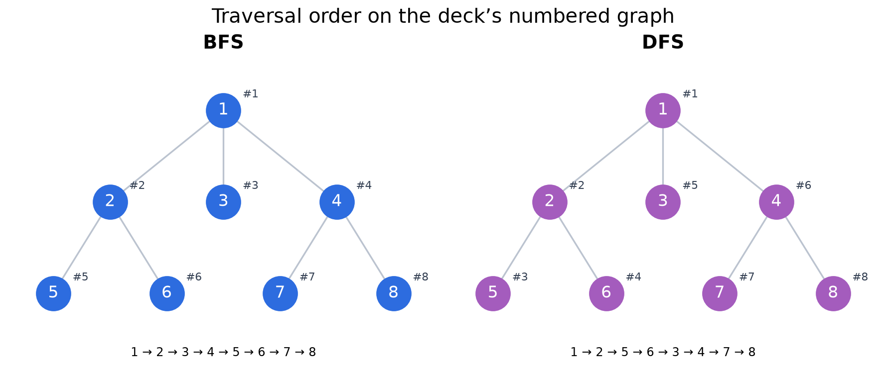
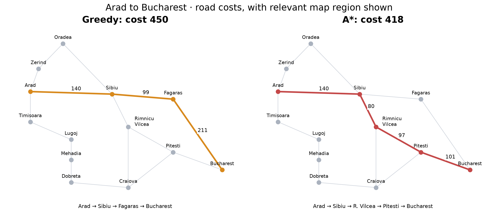
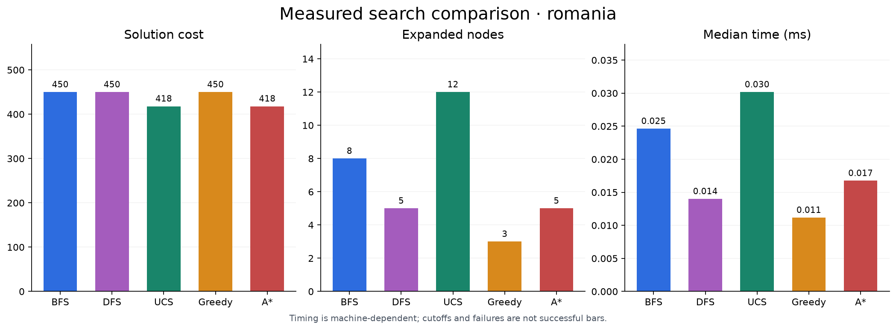

# Search Algorithms in Python

**BFS, DFS, uniform-cost search, greedy best-first search, and A*** implemented
with Python's standard library. Includes every problem example from
*Topic 2: Problem Solving using Search*: traversal graphs, Romania routes,
three 8-puzzle examples, travelling salesperson, and Königsberg's bridges.

## Run

Install [uv](https://docs.astral.sh/uv/getting-started/installation/), then:

```bash
git clone https://github.com/shayyz-code/searches.git
cd searches
uv sync --locked
uv run searches run --problem romania --algorithm astar
uv run searches run --problem letter_graph --algorithm bfs --trace
uv run searches run --problem puzzle_walkthrough --algorithm dfs --depth-limit 5
uv run searches run --problem numbered_graph --algorithm dfs --traverse
uv run searches compare
```

`compare` benchmarks all **15 instances × 5 algorithms**, with three timing runs
and a separate memory run per pair. CSV, JSON, and plots go to `reports/`.
Each search defaults to 30 seconds and 250,000 expansions; cutoffs are labelled
separately from proven no-solution outcomes. Timings depend on your machine.

For a smaller comparison:

```bash
uv run searches compare --problems romania weighted_trap --repeats 3
uv run searches list
```

## Visual examples

These figures are generated from actual searches and measurements.







UCS and A* find the Romania route costing **418**; greedy finds **450**.
The main puzzle takes **20 optimal moves**, and the TSP optimum is **375**.
Königsberg's original seven-bridge problem has no solution from any starting location.

See [comparisons, guarantees, metrics, and slide coverage](docs/comparisons.md)
for the related algorithm comparisons and corrections to simplified slide claims.

## Develop

Python 3.12+; dependencies and lockfile managed with uv. Code lives in
`src/searches/`, tests in `tests/`, and documentation in `docs/`.

```bash
uv run ruff check .
uv run ruff format --check .
uv run pytest
uv run searches images  # regenerate the three README figures
```

The source PowerPoint is not redistributed. Example data is transcribed from
the supplied deck, which cites Russell & Norvig (2016) and Luger (2011).
